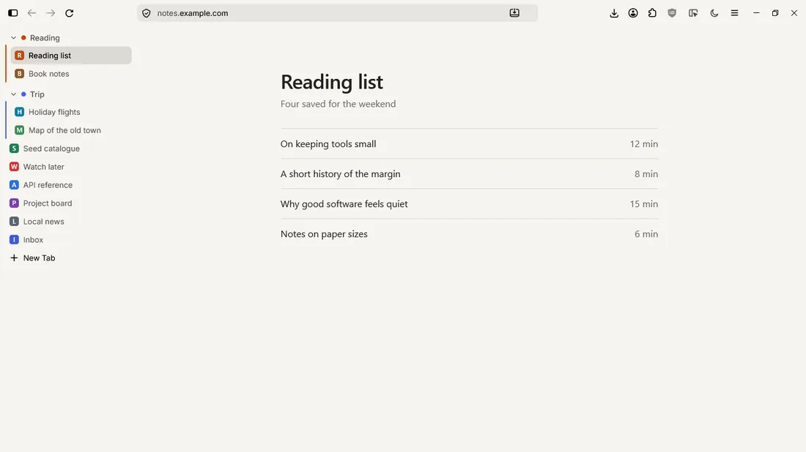

# Stillfox

A quiet Firefox theme inspired by Linear and Apple Notes. No boxes and no borders: just soft fills, thin type, and a browser that takes on the colour of the site you're on.

## What you get

- **One surface.** The toolbar, tab list and page melt together, coloured by the site you're on.
- **A clean tab list.** Just your tabs, with quiet tab groups and no extra buttons.
- **Tabs on the left or on top.** Both layouts are fully styled, and you can switch any time.
- **Hover sidebar (optional).** The list stays a thin rail of icons and slides open when you point at it.
- **Dark and light button (optional).** One click flips websites that support it, with a sun and moon icon.
- **Ultrawide friendly.** Toolbar icons sit at the far right, and the address bar grows while you use it.
- **Calm extensions.** Extension icons stay grey until you hover over them.
- **Inter included.** The font ships with the theme, so there's nothing to install on your system.

## Install

Tested on **Firefox 159 on Windows 10**. Firefox updates can change its internals, so a future version may need small fixes.

1. Download this repo: **Code** > **Download ZIP**, then unzip it.
2. In Firefox, go to `about:support`. Next to **Profile Folder**, click **Open Folder**.
3. Copy the `chrome` folder from this repo into that profile folder.
4. Go to `about:config` and set `toolkit.legacyUserProfileCustomizations.stylesheets` to `true`.
5. Install [Adaptive Tab Bar Colour](https://addons.mozilla.org/en-US/firefox/addon/adaptive-tab-bar-colour/). This is what colours the browser to match each site.
6. Restart Firefox.
7. Right-click the **sidebar icon** at the top left and choose **Turn on Vertical Tabs**.

> The option only appears when you right-click that icon, not empty toolbar space. You can also change it in Settings: search for `vertical tabs` and look under **Browser layout**.

## Optional buttons

CSS can't add working buttons by itself, so these two use small add-ons. Pin each one to your toolbar after installing it.

### Hover sidebar

1. Install [Userchrome Toggle](https://addons.mozilla.org/en-US/firefox/addon/userchrome-toggle/).
2. Open its options from `about:addons`.
3. Uncheck **Display a notification when toggling a style** and press **Apply changes**.
4. Set the first style's name to `hover sidebar` and press its **Apply changes**. This makes the tooltip readable.

A new Firefox window starts in normal mode until you click the button in that window.

### Dark and light

Install [Color Scheme Toggle](https://addons.mozilla.org/en-US/firefox/addon/color-scheme-toggle/). Stillfox gives it the sun and moon icons. It only affects sites that support dark mode, and the sun or moon shows how the browser looks right now.

## Good to know

**Switching between left and top:** right-click the sidebar icon at the top left and choose **Turn off Vertical Tabs** or **Turn on Vertical Tabs**.

**Tidying the toolbar:** turning on vertical tabs can move **Firefox View** and **List all tabs** onto your toolbar. Right-click each one and choose **Remove from Toolbar** if you don't want them.

**History, Bookmarks and Passwords:** the sidebar's bottom row is hidden, so these live in the ☰ menu at the top right.

**No animations?** If Windows animations are off, Firefox turns off its own too. In `about:config`, create a Number setting called `ui.prefersReducedMotion` with the value `0`.

**Slow colour change?** Adaptive Tab Bar Colour waits for a page to mostly finish loading, so a first visit to a heavy site can take a couple of seconds. Repeat visits are much quicker.

## Customise

The numbers worth changing are at the top of [`chrome/userChrome.css`](chrome/userChrome.css). Restart Firefox after editing.

| Setting | Default | What it does |
| --- | --- | --- |
| `--sf-sidebar-width` | `232px` | Width of the tab list |
| `--sf-row` | `30px` | Height of each tab row |
| `--sf-radius` | `7px` | Roundness of rows and buttons |
| `--sf-card-radius` | `10px` | Roundness of the page corners |
| `--sf-gap` | `8px` | Space around the page |
| `--sf-font-size` | `13px` | Interface text size |
| `--sf-url-max` | `680px` | Address bar width |
| `--sf-url-focus` | `880px` | Address bar width while you use it |
| `--sf-left-buttons` | `4` | Buttons left of the address bar, which keeps it lined up with the page |

## Uninstall

Delete the `chrome` folder from your profile folder and restart Firefox.

## Credits

- [Inter](https://github.com/rsms/inter) by The Inter Project Authors, under the [SIL Open Font License 1.1](chrome/fonts/LICENSE-Inter.txt).
- Stillfox isn't affiliated with Mozilla. Firefox is a trademark of the Mozilla Foundation.

## License

[MIT](LICENSE), except the Inter font, which keeps its own licence.
